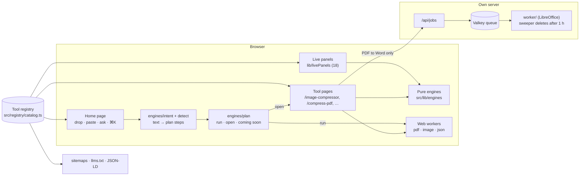

# KlipKit

Free online tools that run on your device. Drop a file, paste something, or say what you need ("compress to under 2 mb and split pages 1-5"), and KlipKit builds a plan and runs it in your browser.

- **Next.js 16** (App Router, static pages, Turbopack), Tailwind 4, Zustand.
- **Self-hosted only:** no third-party APIs, no CDNs, no AI server. Fonts via `next/font/local`.
- **Private by default:** 25 of the 26 live tools never upload anything. PDF to Word uses KlipKit's own server, and files are deleted after one hour.
- **Plans:** Free and Pro.

Status: 79 tools in the registry, 26 live, the rest labelled "Coming soon". Test results: [reports/tools-e2e-report.md](reports/tools-e2e-report.md).

## How it fits together



- **One registry** (`src/registry/catalog.ts`) lists every tool: slug, status, where it runs, inputs and outputs, synonyms. The home grid, the ⌘K search, routes, sitemaps, `llms.txt` and plan tags are all derived from it ([ADR 0002](docs/adr/0002-registry-single-source.md)).
- **Tool logic lives in pure engines** (`src/lib/engines`). They're unit-tested without a browser ([ADR 0003](docs/adr/0003-pure-engines.md)).
- **Heavy work runs in web workers** (`src/workers`): PDF, images, large JSON.
- **Plans never pretend.** A step either runs for real, opens the tool that can do it, or says "Coming soon" ([ADR 0006](docs/adr/0006-plans-run-for-real.md)).
- **One animation loop** that pauses off screen and under reduced motion ([ADR 0001](docs/adr/0001-single-motion-loop.md)).

## Run locally

```bash
npm install          # also copies browser engines into public/vendor
npm run dev          # http://localhost:3000
```

Production build, as the tests use it:

```bash
npm run build && npm start        # standalone server, static files copied in
```

Server tools (PDF to Word) need Valkey/Redis and the worker:

```bash
redis-server --port 6379 &        # or: docker run -p 6379:6379 valkey/valkey:8-alpine
cd worker && npm install && PATH="/Applications/LibreOffice.app/Contents/MacOS:$PATH" JOBS_DIR=/tmp/klip-jobs node src/index.mjs
JOBS_DIR=/tmp/klip-jobs npm run dev
```

The Background Remover needs the self-hosted model: see [public/models/README.md](public/models/README.md).

## Production

```bash
cp .env.example .env   # fill in secrets
docker compose up -d --build
```

## Add a tool in 5 steps

1. **Engine.** Write the logic as a pure function in `src/lib/engines/<name>.ts`, with no DOM and no React. Add a unit test in `tests/unit/` with known input → output pairs (for example, the expected values in the spec).
2. **Registry.** Add a row to `rows` in `src/registry/catalog.ts` (slug, name, hub, build type, `DEV` or `SRV`, inputs/outputs, synonyms, related). Leave it `planned` until it works. For a home card, add the slug to `src/registry/home.ts`; the order there is the grid order.
3. **UI**, one of:
   - **Live panel** (instant text tools): add the slug to `PANEL_SLUGS` in `catalog.ts`, and a `PanelConfig` to `PANELS` in `src/lib/livePanels.ts` that calls your engine.
   - **Tool page** (files, heavier work): add `src/tools/<Name>.tsx`, built on `ToolWorkspace`. Register it in `src/tools/index.tsx` and set the row to `beta` (routed, `noindex`). Long work goes in a worker in `src/workers/`.
   - If home-page plans should run it, add a case to `planFor()` in `src/lib/engines/plan.ts`.
4. **Content.** Write its `ToolSEO` in `src/registry/seo/<slug>.ts` and set the status to `live`. It's then indexed and listed in the sitemap and `llms.txt`.
5. **Tests.**
   - Live panels are picked up by `tests/e2e/live-panels.spec.ts` automatically.
   - For a page, add it to `TOOLS` in `tests/e2e/tools.spec.ts`, plus a test that checks the actual output (not just that the page loads).
   - Run `npm run verify` and `npm run test:e2e`.
   - `tests/unit/registry.test.ts` fails if the lists disagree.

## Tests

| Command                            | What it runs                                                                          |
| ---------------------------------- | ------------------------------------------------------------------------------------- |
| `npm run verify`                   | typecheck, lint, Prettier check, unit tests (Vitest), production build                |
| `npm run test:e2e`                 | build + Playwright: Chromium, Firefox, WebKit, Pixel 7, iPhone 14, axe, network guard |
| `npm run test:perf`                | Lighthouse CI on 14 pages                                                             |
| `npm run visual`                   | pixel compare against the reference design (`design/reference/KlipKit_UI.html`)       |
| `npx jiti scripts/tools-report.ts` | rebuilds `reports/tools-e2e-*.{json,html}` from the last Playwright run               |

CI (`.github/workflows/test.yml`) runs verify, all Playwright projects and Lighthouse on every push, and uploads the reports.

## Where to read more

- Tools report: [reports/tools-e2e-report.md](reports/tools-e2e-report.md). UI restore: [reports/ui-fix-report.md](reports/ui-fix-report.md). Design audit: [reports/hallmark-audit.md](reports/hallmark-audit.md).
- Every change, with its PR notes: [reports/changelog.md](reports/changelog.md).
- Decisions: [docs/adr/](docs/adr/). Strategy, tool list and SEO plan: [docs/STRATEGY.md](docs/STRATEGY.md).
